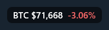
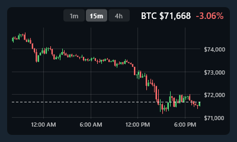

# BTC Ticker

A small live Bitcoin price that floats above World of Warcraft. The ticker never takes focus from the game, so WoW keeps the keyboard. Click the ticker to open a candlestick chart, and click it again to close the chart.

<p>
  
  &nbsp;
  
</p>

It runs on Windows 11, and on macOS 14 or later on Apple silicon and Intel Macs. Windows 10 should work too, but it hasn't been tested. Prices come from Kraken's public API. There's no account, no API key and no tracking.

## Install

| | Download | Then |
| --- | --- | --- |
| **Windows** | [btc-ticker-windows-x64.zip](../../releases/latest/download/btc-ticker-windows-x64.zip) | [Install on Windows](#install-on-windows) |
| **macOS** | [btc-ticker-macos.zip](../../releases/latest/download/btc-ticker-macos.zip) | [Install on macOS](#install-on-macos) |

The apps aren't signed, so Windows and macOS each show a warning the first time you open one. The steps below show how to get past it. Every release is built from this repo's source by [GitHub Actions](.github/workflows/release.yml).

### Install on Windows

1. Download [btc-ticker-windows-x64.zip](../../releases/latest/download/btc-ticker-windows-x64.zip).
2. Right-click the zip, choose **Extract All…**, and click **Extract**. Move `btc-ticker.exe` to any folder you like, such as `Documents`.
3. Double-click `btc-ticker.exe`.
4. If Windows says **Windows protected your PC**, click **More info**, then **Run anyway**. Windows asks only the first time.

The ticker appears at the top center of your main screen. Drag it wherever you want. To change settings or quit, right-click the ticker, or right-click the orange **B** in the notification area by the clock. Windows 11 hides new tray icons behind the **^** arrow until you pin them. To start the ticker with Windows, tick **Start with Windows** in **Settings…**.

### Install on macOS

1. Download [btc-ticker-macos.zip](../../releases/latest/download/btc-ticker-macos.zip). Safari unzips it for you. In other browsers, double-click the zip.
2. Drag **BTC Ticker** into your **Applications** folder.
3. Double-click **BTC Ticker**. macOS refuses to open it the first time, because the app isn't notarized by Apple. Click **Done**, or **Cancel** on macOS 14.
4. Allow the app once:
   - **macOS 15 or later:** open **System Settings** > **Privacy & Security**, scroll down to **"BTC Ticker" was blocked**, click **Open Anyway**, and confirm with your password.
   - **macOS 14:** right-click **BTC Ticker** in Applications, choose **Open**, then click **Open** in the dialog.

If you'd rather use Terminal, this one command replaces step 4:

```sh
xattr -dr com.apple.quarantine "/Applications/BTC Ticker.app"
```

The app has no Dock icon. The ticker appears at the top center of the screen. To change settings or quit, click the bitcoin icon in the menu bar, or right-click the ticker.

### Check a download (optional)

Each release also has `SHA256SUMS.txt`, which holds the SHA-256 checksum of each zip. To check a download, compare its checksum with the line for that zip:

```powershell
Get-FileHash .\btc-ticker-windows-x64.zip -Algorithm SHA256
```

```sh
shasum -a 256 btc-ticker-macos.zip
```

### Update

Download the new zip and replace the old `btc-ticker.exe` or `BTC Ticker.app` with the new one. Quit the old app first. Your settings stay as they are.

## Run WoW in a windowed mode

Set WoW's display mode to **Windowed** or **Windowed (Fullscreen)**. In exclusive **Fullscreen** mode, the game owns the screen and no other window can draw over it, so the ticker is hidden.

## Use the ticker

- Click the ticker to open or close the chart. Click 1m, 15m or 4h on the open chart to switch the timeframe.
- Scroll, turn the mouse wheel or pinch over the open chart to zoom. The game keeps the keyboard and the focus, and it doesn't get the wheel while the pointer is over the chart. On Windows, this holds even with the "Scroll inactive windows when I hover over them" setting turned off.
- While the position is unlocked, drag the ticker to move it. On Windows, you can also drag the open chart, and drag its corner grip, opposite the ticker, to resize it. The new size is saved when you release the mouse.
- **Lock Position** stops dragging and resizing. Clicks still open the chart.
- When the price stops updating, the ticker dims it and marks it stale. On Windows, the mark also says how old the price is, for example `stale 3m`. Hover over the tray icon to see the price, whether it is live, and why it is not updating, for example `Kraken is not answering`. The tooltip works while the ticker is hidden too.

The **Settings** window has these options:

- Font size, decimals (0 to 2), and whether to show the `BTC` label and the change since the daily open.
- Price, up and down colors, and the background opacity.
- Chart width and height. A wider chart draws more bars before neighbouring candles merge into one.
- Refresh interval (2 to 300 seconds, default 5).
- Show only while World of Warcraft is frontmost.
- Lock position, and **Reset position**, which moves the ticker back to the top center of the screen.
- On Windows, **Start with Windows**, which starts the ticker when you sign in. It adds a `BTCTicker` entry under `HKCU\Software\Microsoft\Windows\CurrentVersion\Run` and keeps no copy in the settings file. If you move the exe, untick and tick the box again.

The app also remembers the last timeframe you chose and the last zoom.

## Settings and reset

Settings are saved as soon as you change them. A saved position that no longer fits a screen is pulled back into the visible area.

On Windows, settings are a JSON file at `%APPDATA%\BTCTicker\settings.json`. The app applies edits to the file as soon as you save them, including edits made by hand. To reset every setting, quit the app, delete the file, and start the app again.

On macOS, settings are stored in the `dev.local.btcticker` defaults domain, under the key `btcTickerSettings`. To reset every setting, quit the app, run this command, and start the app again:

```sh
defaults delete dev.local.btcticker
```

The two apps do not share a settings format. Windows saves positions in physical pixels and macOS saves them in points, so you can't copy one app's settings to the other.

## Quit and uninstall

To quit, choose **Quit BTC Ticker** from the ticker's right-click menu. On Windows, the tray icon's menu has the same item. On macOS, the menu bar icon's menu has it.

Neither app has an installer.

- To uninstall on Windows, quit the app, then delete `btc-ticker.exe` and the `%APPDATA%\BTCTicker` folder.
- To uninstall on macOS, quit the app, move `BTC Ticker.app` to the Trash, then run `defaults delete dev.local.btcticker`.

## Privacy

The apps send only two kinds of request, both HTTPS GETs to Kraken's public REST API at `api.kraken.com`:

- `https://api.kraken.com/0/public/Ticker?pair=XBTUSD` for the price, once per refresh interval, and less often after repeated failures.
- `https://api.kraken.com/0/public/OHLC?pair=XBTUSD&interval=<minutes>` for the candles, only while the chart is open.

There are no accounts, no API keys, no analytics and no telemetry. Like any web request, a request to Kraken shows Kraken your IP address. Settings stay on your computer.

## Disclaimer

BTC Ticker is not affiliated with or endorsed by Blizzard Entertainment or Kraken. World of Warcraft is a trademark of Blizzard Entertainment.

The app draws only its own window above the game. It never reads the game's memory or files, injects code into the game, sends input to the game, or automates it. To show the ticker only while WoW is frontmost, it asks the operating system which app is in front.

Prices are for information only. They can be delayed or wrong, and nothing in this app is financial advice.

## Build from source

### macOS

Swift 6.1 from the Xcode Command Line Tools is enough. The app runs on macOS 14 or later.

```sh
./scripts/bundle.sh              # builds "build/BTC Ticker.app"
open "build/BTC Ticker.app"
```

That builds for your Mac's own processor. To build one app for both Apple silicon and Intel, as the releases are, run `UNIVERSAL=1 ./scripts/bundle.sh`. That needs the full Xcode, not only the Command Line Tools.

### Windows

The Windows app is built from the Cargo workspace at the repo root. The pure `crates/ticker-core` crate decides everything, and `windows/btc-ticker` is the Win32 shell around it. It needs only the Rust toolchain (1.98 or later, MSVC target), with no C compiler or resource compiler.

```powershell
cargo build --release
.\target\release\btc-ticker.exe
```

## Verify a change

[CONTRIBUTING.md](CONTRIBUTING.md) explains how to work on the code. Each platform has one script that is the exit condition of its verify loop.

### macOS: `scripts/verify.sh`

`./scripts/verify.sh` prints one PASS, FAIL or INCONCLUSIVE line per check and exits 0 only when every line is PASS.

- A release build with warnings treated as errors.
- Unit tests over the pure `TickerCore` library, run against Kraken responses recorded in `Tests/TickerCoreTests`. One of them is an exhaustive model check. It walks every state the overlay reducer can reach under every event and asserts the invariants in each one. For example, a click never moves the ticker, and a locked ticker never drags.
- The app bundle, checked with `plutil -lint` and `codesign --verify`.
- End-to-end checks against the built app with a live Kraken feed. They check that the window sits on a higher layer than the WoW window, that WoW stays frontmost, that every timeframe loads its candles, that scrolling zooms out to every candle and back, and that the panel catches clicks even at opacity 0. They also save screenshots to `build/expanded-*.png`.

The end-to-end clicks and scrolls are synthesized `NSEvent`s sent through the panel, not real mouse input, and the check's name says so. Real input needs Accessibility permission for the terminal that runs the script. The `e2e-above-wow` check needs a WoW window under the ticker.

### Windows: `windows\scripts\verify.ps1`

Run this from the repo root:

```powershell
powershell -NoProfile -ExecutionPolicy Bypass -File windows\scripts\verify.ps1
```

It builds with warnings denied, runs clippy and the core's unit tests and model checks, then runs `btc-ticker-e2e` against the release exe. That end-to-end check covers the primary monitor with a stand-in game window, a copy of itself named `Wow.exe`, for about a minute and drives the app with real mouse input through `SendInput`.

Don't touch the mouse while it runs. It refuses to click any window but its own and the app's. If it sees the cursor move or presses it did not send, it stops sending input and reports that check INCONCLUSIVE and every later one INCONCLUSIVE as not run. It then still quits or kills the app it launched and checks that nothing is left behind.

It also drags and resizes the open chart, checks that resizing respects the lock and saves the size, turns the wheel over the chart, and for a moment switches wheel routing to the focused window for this session only. It saves screenshots of the collapsed ticker, each timeframe's chart, the widest zoom and the Settings window to `target/verify/*.png`. The app it launches uses a throwaway settings file, never yours, and its Start with Windows entry goes under `HKCU\Software\BTCTicker-test`, never your Run key.

## License

BTC Ticker is released under the [MIT License](LICENSE).

Created in [T3 Code](https://t3.codes).
